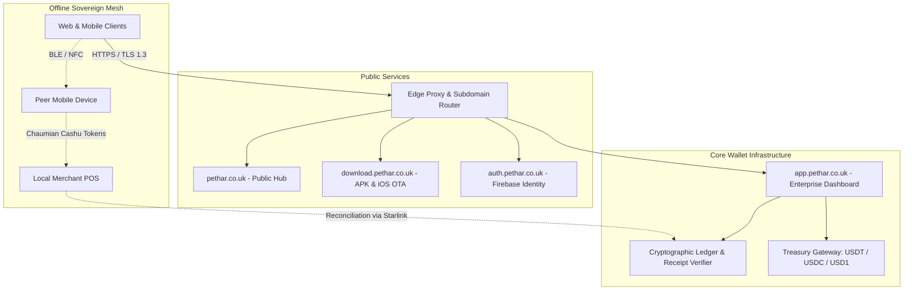

# Péthar (ဖေ့သာ) — Enterprise System Architecture

```
                                  [ DNS Gateway: Cloudflare / AWS ]
                                                  │
                 ┌────────────────────────────────┴────────────────────────────────┐
                 ▼                                                                 ▼
      [ Public Edge: pethar.co.uk ]                                     [ Subdomain Applications ]
      • Enterprise Landing                                              • app.pethar.co.uk (Wallet Hub)
      • Direct Mobile Download Hub                                      • auth.pethar.co.uk (Identity)
      • 1 ₳ = $1.00 USD Collateral Transparency                         • admin.pethar.co.uk (Treasury)
                 │                                                      • docs.pethar.co.uk (API Specs)
                 │
                 ▼
 ┌───────────────────────────────┐
 │       Péthar Monorepo         │
 ├───────────────────────────────┤
 │ 🌐 pethar-wallet (Web & PWA)  │ ◄── React 19 + TypeScript + Vite + Tailwind CSS (m.pethar.co.uk)
 │ 📱 pethar-wallet (Mobile Core)│ ◄── Flutter 3.x / Swift / Kotlin (android/, ios/, macos/, lib/)
 │ 🗄️ Database & Cloud Firestore  │ ◄── Drizzle ORM + PostgreSQL + Firebase Auth
 └───────────────────────────────┘
```

---

## 1. Multi-Tier Distributed Topology



---

## 2. Stable Currency Peg (1 ₳ = $1.00 USD)

* **Arakan Dollar (₳):** Unit of account for community commerce, remittances, and retail settlements.
* **Collateralization:** 100% backed by segregated reserves in **USDT**, **USDC**, and **USD1**.
* **Zero Gas Exposure:** End-users interact purely with ₳ without needing gas tokens (ETH, TRX, SOL). Gas abstraction is managed through internal enterprise relayer pools.

---

## 3. Dual Connectivity Engine: Online + Offline

### Online Mode
* Real-time balance updates via WebSocket listeners.
* Instant P2P transfers settled in sub-500ms.
* Deterministic e-Receipt generation with cryptographic verification QR codes.

### Offline Mode (Exclusively on Android & iOS)
* Built upon a **Cashu-inspired Chaumian e-cash** blind signature model.
* Bearer tokens stored encrypted in device hardware secure storage (KeyStore / Secure Enclave).
* Transported peer-to-peer via Bluetooth Low Energy (BLE) peripheral/central handshakes, NFC Tap-to-Pay, and dynamic 2D animated QR matrices.
* Zero requirement for cell towers, cellular data, or internet connectivity.
* When either party re-establishes internet or connects to a Starlink terminal, batched signatures are posted and settled to the central ledger.

---

## 4. Subdomain Mapping & Routing

* `pethar.co.uk` & `www.pethar.co.uk`: Public marketing, value proposition, and technology overview.
* `download.pethar.co.uk`: Direct APK downloads with SHA-256 integrity checksums, and iOS configuration profiles (`.mobileconfig`).
* `auth.pethar.co.uk`: High-security authentication gateway with Google Sign-In and email credentials.
* `app.pethar.co.uk`: Unified customer wallet, cards center, analytics, and transaction verification.
* `admin.pethar.co.uk`: Treasury ops, multi-sig reserve auditing, and node telemetry.
* `docs.pethar.co.uk`: Technical documentation, API endpoints, and SDK specifications.
* `privacy.pethar.co.uk`: Regulatory disclosures, Google limited use compliance, and data subject rights.
