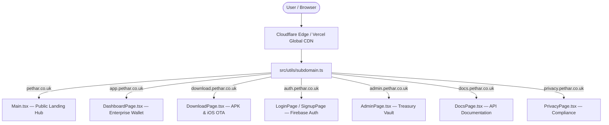

# Péthar Enterprise Architecture Specification

## 1. Monorepo Structural Blueprint

Péthar organizes its multi-platform applications and shared libraries into an enterprise monorepo:

```
PeThar/
├── .github/                     # Enterprise CI/CD, Auditing & PR Enforcement
├── pethar-wallet/               # Web Application, Subdomain Router & Landing Hub
├── pethar_mobile/               # Native Android & iOS Flutter Application
├── apps/                        # Platform launcher bridges (Android, iOS, Desktop, Web, POS)
├── docs/                        # Enterprise Architecture, Security & Compliance
├── db/                          # Database schemas & SQL migrations
├── drizzle/                     # Drizzle ORM definitions
└── supabase/                    # Supabase configurations
```

---

## 2. Distributed Subdomain Infrastructure

Péthar routes incoming client traffic to domain-specific application handlers using deterministic subdomain routing:



---

## 3. Cryptographic Receipt Verification Architecture

Every transaction committed online or reconciled offline produces a deterministically verifiable receipt:

1. **Receipt Generation:**
   - Unique reference identifier: `500...` (14-digit integer).
   - Sender & recipient public IDs, timestamp, and transaction category.
2. **Scannable QR Matrix:**
   - Formatted payload: `https://app.pethar.co.uk/verify/${refId}`.
   - Encoded as a high-density, error-tolerant QR code.
3. **On-Ledger Verification:**
   - Scanning or clicking the QR code queries the public transparency ledger.
   - Validates the Merkle inclusion proof against the block header.
   - Confirms 1 ₳ = $1.00 USD reserve collateralization.
